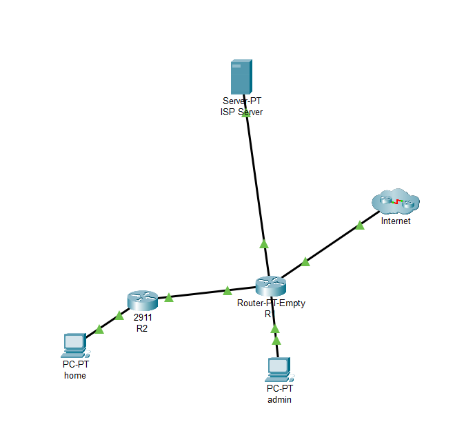

# Отчет по лабораторной работе №2
**Тема:** Настройка удаленного доступа, DHCP, NAT, ACL
**Выполнил:** Мазов С. М., гр. 409

## Топология



## Ответы на вопросы

1. При проверка подключения по SSH сработал только ssh т.к. на виртуальных терминалах установлен только зашифрованный канал управления. При команде telnet вышло сообщение: The current session has closed. Do you want to reestablish a new session with the previous session options?, что означает подключение отклонено.
2. Вывод команды show ip interface Gi0/0
```
GigabitEthernet0/0 is up, line protocol is up (connected)
  Internet address is 192.168.20.2/24
  Broadcast address is 255.255.255.255
  Address determined by DHCP
  MTU is 1500 bytes
  Helper address is not set
  Directed broadcast forwarding is disabled
  Outgoing access list is not set
  Inbound  access list is not set
  Proxy ARP is enabled
  Security level is default
  Split horizon is enabled
  ICMP redirects are always sent
  ICMP unreachables are always sent
  ICMP mask replies are never sent
  IP fast switching is disabled
  IP fast switching on the same interface is disabled
  IP Flow switching is disabled
  IP Fast switching turbo vector
  IP multicast fast switching is disabled
  IP multicast distributed fast switching is disabled
  Router Discovery is disabled
  IP output packet accounting is disabled
  IP access violation accounting is disabled
  TCP/IP header compression is disabled
  RTP/IP header compression is disabled
  Probe proxy name replies are disabled
  Policy routing is disabled
  Network address translation is disabled
  BGP Policy Mapping is disabled
  Input features: MCI Check
  WCCP Redirect outbound is disabled
  WCCP Redirect inbound is disabled
  WCCP Redirect exclude is disabled
```
IP-адрес R2 192.168.20.2/24

2.1 Маршрут по умолчанию - 0.0.0.0/0
2.2 Next-hop - 192.168.20.1

3. IP-адрес ПК home - 192.168.10.2/24. ДА, шдюз и DNS-сервер совпадают.
4. Вывод команды show ip dhcp binding:
```
IP address       Client-ID/              Lease expiration        Type
                 Hardware address
192.168.10.2     00D0.FF54.734D           --                     Automatic
```
Вывод команды show ip dhcp pool:
```
IP address       Client-ID/              Lease expiration        Type
                 Hardware address
192.168.10.2     00D0.FF54.734D           --                     Automatic
R2#show ip dh
R2#show ip dhcp pool

Pool DHCP-POOL :
 Utilization mark (high/low)    : 100 / 0
 Subnet size (first/next)       : 0 / 0 
 Total addresses                : 254
 Leased addresses               : 1
 Excluded addresses             : 1
 Pending event                  : none

 1 subnet is currently in the pool
 Current index        IP address range                    Leased/Excluded/Total
 192.168.10.1         192.168.10.1     - 192.168.10.254    1    / 1     / 254
```
5. В одну сторону все идет прекрасно, но когда пакет идет от сервера к R1, то теряется
потому что в R1 воткнут admin с ip-адресом 192.168.10.100. 
А у роутера имеется запись, C 192.168.10.0/24 is directly connected (напрямую подключена к его собственному порту!) 
и решает, что адресат сидит прямо рядом с компьютером admin. Следовательно пакет отправляется, адресата не находит и теряется.

6. Все пингуется успешно.
7. Вывод таблицы трансляций на R2.
```
Pro  Inside global     Inside local       Outside local      Outside global
icmp 192.168.20.2:21   192.168.10.2:21    100.0.0.2:21       100.0.0.2:21
icmp 192.168.20.2:22   192.168.10.2:22    100.0.0.2:22       100.0.0.2:22
icmp 192.168.20.2:23   192.168.10.2:23    100.0.0.2:23       100.0.0.2:23
icmp 192.168.20.2:24   192.168.10.2:24    100.0.0.2:24       100.0.0.2:24
```
8. Команда ping 8.8.8.8 с ПК home не прошла. R2 подменяет локальный адрес компьютера на 192.168.20.2, который тоже является приватным. Поскольку R1 не настроена трансляция этой подсети в публичный IP-адрес, трафик с приватным адресом отбрасывается на границе облака Internet.
Приватные диапазоны IPv4 (RFC 1918):
	• 10.0.0.0/8 (10.0.0.0 – 10.255.255.255)
	• 172.16.0.0/12 (172.16.0.0 – 172.31.255.255)
	• 192.168.0.0/16 (192.168.0.0 – 192.168.255.255)
Использование в Интернете без трансляции недопустимо. Приватные адреса не уникальны и не маршрутизируются в глобальной сети. Для выхода в Интернет обязательна трансляция NAT в публичный адрес.

9. 8.8.8.8 и 100.0.0.2 пингуются успешно.
Вывод таблицы трансляций на R1:
```
Pro  Inside global     Inside local       Outside local      Outside global
icmp 100.0.0.9:41      192.168.20.2:41    8.8.8.8:41         8.8.8.8:41
icmp 100.0.0.9:42      192.168.20.2:42    8.8.8.8:42         8.8.8.8:42
icmp 100.0.0.9:43      192.168.20.2:43    8.8.8.8:43         8.8.8.8:43
icmp 100.0.0.9:44      192.168.20.2:44    8.8.8.8:44         8.8.8.8:44
```
Для пакетов, идущих к 8.8.8.8, трансляция создается, а для пакетов к 100.0.0.2 . Для первых пакетов создана внешняя сеть и когда пакет от пк заходит на внутренний порт R1  и маршрутизируется на выход через внешний порт,  роутер подменяет приватный адрес на публичный из пула NAT-POOL и записывает эту связь в таблицу трансляций. Для вторых же, сервер подключён к отдельному локальному интерфейсу R1, на котором не настроена роль ip nat outside, и значит что подмена адресов не нужна.

10. Соединиение SSH устанавливается успешно. С точки зрения ИБ это не безопасно, ведь даже не зная пароль, можно
включить автоподбор, ну и обычные клиенты не должны иметь доступ к интерфейсам сетевым устройствам.

11. Проверил подключение, итог нет возможности войти с любых ip-адресов.
12. Вывод команды show ip access-lists TO-SERVER:
```
Extended IP access list TO-SERVER
    permit ip 192.168.10.0 0.0.0.255 100.0.0.0 0.0.0.3
    permit udp any host 100.0.0.2 eq domain
    permit udp any eq domain host 100.0.0.2
    permit tcp any host 100.0.0.2 eq www
    permit icmp 192.168.10.0 0.0.0.255 host 100.0.0.2 echo
```
13. Эхо-запросы блокирует правило запрета всего остального трафика в конце списка доступа.
14. Избыточным является правило permit icmp 192.168.10.0 0.0.0.255 host 100.0.0.2 echo (а также правило получения ответов от внешних DNS permit udp any eq domain host 100.0.0.2), так как его счётчик совпадений всегда остаётся нулевым. Поскольку маршрутизатор проверяет список доступа строго сверху вниз, все эхо-запросы от админской сети 192.168.10.0/24 к серверу 100.0.0.2 попадают под самое первое, более широкое правило permit ip 192.168.10.0 0.0.0.255 100.0.0.0 0.0.0.3, которое уже разрешает абсолютно любой IP-трафик (включая ICMP) к подсети сервера, из-за чего до отдельного правила ICMP проверка просто не доходит (а локальный DNS-сервер 100.0.0.2 не делает запросов к внешним DNS).
15. Маршрутизатор R1 успешно синхронизирует время, так как в операционной системе Cisco IOS исходящие списки доступа (out) проверяют только транзитный трафик (пакеты, пересылаемые от других устройств), и не распространяются на трафик, сгенерированный самим маршрутизатором. Поскольку NTP-запросы создаются локально самим роутером R1, они не блокируются списком TO-SERVER, а ответные пакеты от сервера свободно проходят через интерфейс Gi1/0 во входящем направлении, где ACL отсутствует.
